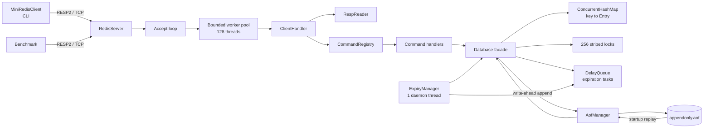

# Mini Redis (Java 21)

A lightweight, Redis-inspired in-memory database built from scratch with Java 21 and the
standard library. It accepts many simultaneous TCP clients, supports strings, expiration,
atomic counters, lists, sets, an append-only file (AOF), restart recovery, and includes a
command-line client, an automated test suite, and a benchmark utility.

No Spring, no external database, and no runtime dependencies. Maven is used only for the
build and JUnit 5 tests.

> This is an educational project, not a production Redis replacement. It implements a
> deliberately small command set with careful attention to concurrency, persistence, and
> testability.

---

## Table of contents

1. [Features](#features)
2. [Architecture](#architecture)
3. [Technology stack](#technology-stack)
4. [Project structure](#project-structure)
5. [Build and run](#build-and-run)
6. [Command-line client](#command-line-client)
7. [Supported commands](#supported-commands)
8. [Protocol](#protocol)
9. [Concurrency strategy](#concurrency-strategy)
10. [Storage design](#storage-design)
11. [Expiration](#expiration)
12. [AOF persistence and recovery](#aof-persistence-and-recovery)
13. [Testing](#testing)
14. [Benchmarks](#benchmarks)
15. [Limitations](#limitations)
16. [Future improvements](#future-improvements)
17. [Java concepts for interviews](#java-concepts-for-interviews)
18. [Five decisions to understand](#five-decisions-to-understand)

---

## Features

- TCP server built on `ServerSocket` and blocking `Socket` I/O.
- Bounded worker thread pool; at least 100 concurrent clients are tested.
- Thread-safe storage using `ConcurrentHashMap` plus per-key striped locking.
- Strings, lists, and sets with strict `WRONGTYPE` checks.
- Absolute-time expiration with lazy checks and a background `DelayQueue` sweeper.
- Atomic `INCR` / `DECR` under concurrent load.
- Append-only persistence with CRC32 checksums, crash-tail handling, and startup replay.
- Durability policy: `always` (fsync every mutation, default), `everysec`, or `no`.
- RESP2 server protocol plus Redis-style inline commands with quoted values.
- Interactive CLI that speaks RESP2 over TCP.
- 71 JUnit 5 tests: unit, expiration, persistence ordering, networking, and concurrency.
- Separate closed-loop benchmark utility with latency percentiles.

---

## Architecture



**Request flow**

1. The accept loop receives a socket and submits it to the bounded pool.
2. A worker reads one RESP array (or inline line), executes it through the registry, writes
   the reply, then reads the next command on the same connection.
3. A mutation is appended and flushed to the AOF *before* the in-memory change is published.
4. The reply is written only after both the AOF write and the memory update succeed.
5. Expiration is checked lazily on reads and actively by one sweeper thread.

---

## Technology stack

| Concern | Choice |
|---|---|
| Language | Java 21 |
| Build | Maven 3.9.9 (wrapper included) |
| Tests | JUnit 5 (Jupiter 5.11.4) |
| Networking | `ServerSocket`, blocking `Socket`, bounded `ThreadPoolExecutor` |
| Storage | `ConcurrentHashMap` + striped `ReentrantLock`s |
| Expiration | `DelayQueue` + a single daemon sweeper |
| Persistence | Custom binary-framed AOF containing RESP-encoded commands |
| Logging | `java.util.logging` |
| Runtime dependencies | None |

---

## Project structure

```text
mini-redis/
├── pom.xml
├── mvnw, mvnw.cmd
├── .mvn/wrapper/maven-wrapper.properties
├── README.md
├── .gitignore
├── data/
├── benchmark-inmemory.txt
├── benchmark-aof.txt
└── src/
    ├── main/java/com/miniredis/
    │   ├── Main.java                  # server entry point and options
    │   ├── server/
    │   │   ├── ServerConfig.java
    │   │   ├── RedisServer.java       # accept loop, pool, lifecycle
    │   │   └── ClientHandler.java     # one connection's read/execute/write loop
    │   ├── client/
    │   │   ├── RedisConnection.java   # blocking RESP client
    │   │   └── MiniRedisClient.java   # interactive CLI
    │   ├── command/
    │   │   ├── CommandRegistry.java   # dispatch and error translation
    │   │   └── handlers/              # SET/GET, TTL, counters, lists, sets, utility
    │   ├── storage/
    │   │   ├── Database.java          # thread-safe operations + WAL ordering
    │   │   ├── Entry.java, ValueType.java
    │   │   ├── KeyLockManager.java    # striped locks
    │   │   ├── ExpiryTask.java
    │   │   └── exception types
    │   ├── expiry/ExpiryManager.java
    │   ├── persistence/
    │   │   ├── AofManager.java        # framing, replay, fsync
    │   │   ├── MutationLog.java
    │   │   └── PersistenceException.java
    │   ├── protocol/
    │   │   ├── RespReader.java, RespProtocol.java
    │   │   ├── Response.java          # sealed reply model
    │   │   ├── InlineCommandParser.java
    │   │   └── ProtocolException.java
    │   └── benchmark/Benchmark.java
    └── test/java/com/miniredis/
        ├── support/TestClient.java
        ├── storage/DatabaseTest.java
        ├── storage/DatabaseConcurrencyTest.java
        ├── expiry/ExpirationTest.java
        ├── command/CommandRegistryTest.java
        ├── persistence/AofPersistenceTest.java
        ├── persistence/PersistenceOrderingTest.java
        ├── server/ServerIntegrationTest.java
        └── server/ServerConcurrencyTest.java
```

---

## Build and run

### Prerequisites

- JDK 21 (`java -version`)
- Maven is optional because the wrapper is committed. If you have Maven installed, `mvn`
  also works.

### Build

Windows PowerShell:

```powershell
.\mvnw.cmd clean package
```

macOS / Linux:

```bash
./mvnw clean package
```

The executable server JAR is `target/mini-redis-1.0.0.jar`.

### Start the server

```powershell
java -jar target\mini-redis-1.0.0.jar
```

Defaults: `127.0.0.1:6379`, AOF at `data/appendonly.aof`, `fsync=always`.

```powershell
java -jar target\mini-redis-1.0.0.jar --port 6380 --bind 127.0.0.1 --fsync everysec
```

Server options:

| Option | Default | Meaning |
|---|---|---|
| `--port N` | `6379` | TCP port (`0` picks a free port) |
| `--bind ADDR` | `127.0.0.1` | Bind address; use `0.0.0.0` to expose on the LAN |
| `--aof PATH` | `data/appendonly.aof` | AOF location |
| `--no-aof` | off | Disable persistence |
| `--fsync always\|everysec\|no` | `always` | Durability policy for writes |
| `--workers N` | `128` | Maximum client worker threads |
| `--queue N` | `256` | Pending connection queue capacity |
| `--max-clients N` | `256` | Maximum simultaneously open connections |
| `--help` | | Show usage |

Stop with `Ctrl+C`; a shutdown hook closes the listener, clients, expiry thread, and AOF.

### Run tests

```powershell
.\mvnw.cmd test
```

### Run the benchmark

```powershell
java -cp target\classes com.miniredis.benchmark.Benchmark
java -cp target\classes com.miniredis.benchmark.Benchmark --requests 1000 --clients 1,10,50,100
java -cp target\classes com.miniredis.benchmark.Benchmark --requests 500 --clients 1,10,50 --aof
```

The benchmark starts an in-process server on a free loopback port, so it does not need a
separately running server.

---

## Command-line client

The CLI connects to `localhost:6379` by default and uses the same RESP2 protocol as the
server.

```powershell
java -cp target\mini-redis-1.0.0.jar com.miniredis.client.MiniRedisClient
```

```text
Connected to Mini Redis at localhost:6379
Type commands, or 'exit' to quit. Quote values containing spaces.
localhost:6379> SET name Rahul
OK
localhost:6379> GET name
Rahul
localhost:6379> INCR visits
(integer) 1
localhost:6379> SET token abc EX 60
OK
localhost:6379> TTL token
(integer) 60
localhost:6379> LPUSH tasks "write tests"
(integer) 1
localhost:6379> RPOP tasks
write tests
```

Options:

```text
--host HOST       default localhost
--port PORT       default 6379
--timeout MILLIS  connection timeout, default 5000
--command CMD     execute one command and exit
--help
```

One-shot examples:

```powershell
java -cp target\mini-redis-1.0.0.jar com.miniredis.client.MiniRedisClient --command "GET name"
java -cp target\mini-redis-1.0.0.jar com.miniredis.client.MiniRedisClient --port 6380 --command "PING"
```

Values with spaces must be quoted when typed interactively. In PowerShell, quoting a
`--command` argument that itself contains quotes can be awkward; interactive mode or a RESP
client avoids that shell issue.

---

## Supported commands

Commands are case-insensitive. Keys and values are case-sensitive.

### Strings and keys

| Command | Behavior |
|---|---|
| `SET key value` | Store a string; overwrites any existing type and clears any TTL |
| `SET key value EX seconds` | Store with expiration; `seconds` must be a positive integer |
| `GET key` | Bulk string, or nil if missing; `WRONGTYPE` for a list/set |
| `DEL key` | `1` if removed, `0` if missing |
| `EXISTS key` | `1` or `0` |
| `KEYS` | Array of all live keys, sorted for deterministic output |

### Expiration

| Command | Behavior |
|---|---|
| `TTL key` | Remaining seconds; `-1` no expiry; `-2` missing/expired |
| `PERSIST key` | Remove expiration; `1` changed, `0` unchanged/missing |

`TTL` rounds remaining time up to the next whole second, so a fresh `SET ... EX 60`
immediately reports `60`.

### Counters

| Command | Behavior |
|---|---|
| `INCR key` | Atomically add 1; missing key starts at 0; TTL preserved |
| `DECR key` | Atomically subtract 1; missing key starts at 0; TTL preserved |

Non-numeric values return `ERR value is not an integer or out of range`. Overflow returns
`ERR increment or decrement would overflow`. Both are checked with `Math.addExact`, so an
overflow never silently wraps.

### Lists

| Command | Behavior |
|---|---|
| `LPUSH key value` | Push at the head; returns new length |
| `RPOP key` | Pop from the tail; nil if missing; deletes the key when the list empties |
| `LLEN key` | Length, `0` if missing |

Example: `LPUSH letters a`, `LPUSH letters b` produces `b,a` from head to tail; `RPOP`
returns `a`.

### Sets

| Command | Behavior |
|---|---|
| `SADD key member` | Add member; returns `1` if new, `0` if already present |
| `SISMEMBER key member` | `1` or `0` |
| `SCARD key` | Cardinality, `0` if missing |

### Utility

| Command | Behavior |
|---|---|
| `PING` / `PING message` | `PONG` / echo the message |
| `ECHO message` | Echo as a bulk string |
| `QUIT` | Reply `OK` and close the connection |

### Intentional simplifications

- `DEL`, `LPUSH`, and `SADD` accept exactly one key/member argument.
- `KEYS` has no glob pattern.
- There is no `SET NX`, `EXPIRE`, `MGET`, `SREM`, transactions, pub/sub, or replication.

---

## Protocol

The server accepts two input forms on the same port:

1. **RESP2 arrays** (used by the CLI and real Redis-style clients). Each command is an
   array of bulk strings:

   ```text
   *2\r\n$3\r\nGET\r\n$4\r\nname\r\n
   ```

2. **Inline commands**, for telnet/netcat convenience:

   ```text
   SET greeting "hello world"\r\n
   ```

The inline parser supports single quotes, double quotes, adjacent quoted sections, and
backslash escapes (`\n`, `\r`, `\t`, `\b`, `\a`, `\\`, `\"`, `\xHH`).

Replies always use RESP2: simple strings (`+`), errors (`-`), integers (`:`), bulk strings
(`$`), and arrays (`*`). Null bulk is `$-1\r\n`.

Incoming commands may be fragmented across any number of TCP reads; `RespReader` reads from
a buffered stream and reassembles length-prefixed bulk strings. Multiple pipelined commands
are processed in order.

**RESP2 is tested with the project's own client, not with the official `redis-cli`.** The
implemented subset should be broadly compatible, but compatibility with every `redis-cli`
startup command is not claimed.

---

## Concurrency strategy

### Storage locking

`Database` uses:

- `ConcurrentHashMap<String, Entry>` for scalable key lookup and safe structure access.
- 256 `ReentrantLock` stripes selected by the key's hash. The same key always maps to the
  same lock; different keys usually run in parallel.
- Every operation that touches a key — reads included — takes that key's stripe lock. Reads
  are included so collection sizes and lazy-expiration decisions cannot race with mutation.
- There is no single global database lock. Collisions only reduce parallelism.

### Atomic compound operations

- `INCR`/`DECR`: read, parse, overflow-check, log the resulting value, and replace the entry
  while holding the key lock. Concurrent increments cannot lose updates.
- `LPUSH`/`RPOP`/`SADD`: head/tail/set mutation happens under the key lock, so list order and
  set cardinality stay consistent.
- `SET` overwrites an entry atomically, including changing the value type.
- Expiration deletion takes the same key lock and verifies that the task still matches the
  entry's current absolute expiry. A stale task from an older `SET` or `PERSIST` is ignored.
- `KEYS` is a read-only snapshot and does not mutate the map, avoiding a lock-free deletion
  race.

### Why not `compute` / `ConcurrentHashMap` alone?

`ConcurrentHashMap.compute` is atomic per key, but the operations here also touch the
expiration queue and the AOF, and lists/sets need multi-step collection mutation. An explicit
per-key lock keeps those steps together and is easier to reason about. A single global lock
would be correct but would serialize the entire server, so striped locks were chosen.

### Networking concurrency

- One accept thread, one bounded `ThreadPoolExecutor` (`128` workers by default, queue of
  `256`).
- Each connection is handled by one worker thread for its lifetime.
- A slow or idle client blocks only its own worker.
- 100 simultaneous connections and 100 clients incrementing one counter are covered by tests.
- `maxConnections` caps live sockets. When the pool/queue is exhausted, the server replies
  `ERR server is busy` and closes the new socket rather than creating unbounded threads.
- Sockets use `TCP_NODELAY`, keep-alive, and a 5-minute idle timeout by default.
- Disconnect, protocol error, and idle timeout are contained to one worker. Resource cleanup
  uses try-with-resources.

### AOF serialization

The AOF has one writer lock (all mutations must appear in one total order) and syncs before
the client reply with `fsync=always`. This is a deliberate disk-order bottleneck; the
in-memory storage itself is not globally locked, but durable writes still pay for a single
log stream.

---

## Storage design

```text
Entry
├── type: STRING | LIST | SET
├── value: String | ArrayDeque<String> | LinkedHashSet<String>
└── expiresAtMillis: volatile long (0 = no expiration)
```

- Strings are immutable; `INCR` replaces the entry with a new string.
- Lists use `ArrayDeque`, with `addFirst` for `LPUSH` and `removeLast` for `RPOP`.
- Sets use `LinkedHashSet` (important only for deterministic iteration/debugging).
- An empty list is deleted, matching Redis list behavior.
- `SET` may overwrite a list or set, because that is the documented overwrite rule for this
  project.
- Reading a collection with a string command (or vice versa) returns `WRONGTYPE`.

Expiration is stored as an **absolute epoch-millisecond timestamp**, never as a remaining
duration. That makes it correct across process restarts and wall-clock updates.

---

## Expiration

Two mechanisms cooperate:

1. **Lazy expiration** — every access checks the timestamp. If expired, the key is removed
   and treated as missing. This guarantees callers never observe an expired value.
2. **Background sweeping** — a `DelayQueue<ExpiryTask>` receives a task whenever a key gets
   a TTL. One daemon `ExpiryManager` thread polls due tasks and removes keys under the key
   lock. It logs a `DEL` for the AOF.

Stale tasks are harmless: a task only deletes when its timestamp equals the entry's current
timestamp. Overwriting with `SET` (without `EX`) or calling `PERSIST` therefore cancels the
observable TTL immediately, even though the old queue entry remains until its due time.

`SET` without `EX` clears an existing TTL. `INCR` preserves it. `DEL` removes the key.

On restart, only absolute timestamps are replayed. A key whose timestamp is already in the
past is not restored.

---

## AOF persistence and recovery

### Durability policy

`fsync=always` (default) calls `FileDescriptor.sync()` for every successful mutation before
the reply is sent. `everysec` flushes every write and runs a background sync thread that
fsyncs dirty data at most once per second (a crash can lose up to about one second). `no`
never calls fsync; only the OS flush is guaranteed.

No durability claim is made for `everysec` or `no`, and no claim is made for power loss
without a working filesystem/OS sync.

### File format

```text
"MINIREDIS-AOF-1\n"
repeated:
  int32 payloadLength
  int32 CRC32(payload)
  byte[payloadLength]   // RESP-encoded command array
```

RESP framing makes spaces, quotes, newlines, and other characters unambiguous. The length
and checksum make truncation/corruption detectable.

### Write ordering

For every mutation:

1. Validate and compute the result while holding the key lock.
2. Append the canonical command to the AOF, flush, and optionally fsync.
3. Apply the change to memory.
4. Return the reply to the client.

This is write-ahead logging: a crash after step 2 but before step 4 may replay a command the
client never saw; that is safe, standard at-least-once behavior. A failed AOF append is
returned to the client as `ERR persistence failure: ...` and the in-memory mutation is not
applied. After a partial write, the AOF enters a failed state and rejects further appends, so
the damaged suffix is bounded and can be truncated during the next recovery.

Some operations are canonicalized for replay:

- `INCR`/`DECR` log the resulting `SET key newValue [PXAT timestamp]` rather than the delta,
  so counter recovery is exact and TTL-preserving.
- Runtime expiration cleanup logs `DEL`.
- Lists/sets log `LPUSH`, `RPOP`, and `SADD`.

### Recovery

At startup, `AofManager.load()`:

1. Creates the header for an empty/new file, or verifies the existing magic header.
2. Replays records in file order into the database with logging disabled.
3. Applies absolute expiration timestamps; already-expired values are skipped.
4. **Incomplete final record** (crash during append): stops replay and truncates the file to
   the last complete record.
5. **Checksum or framing corruption**: stops at the last consistent prefix and truncates the
   damaged suffix.
6. **Semantically invalid record** with a valid checksum: skips that record with a warning.
7. Reopens the file in append mode.

A completely wrong magic header is treated as a fatal configuration error rather than
silently overwriting a file that might not belong to this application.

### AOF limitations

- There is no automatic rewrite/compaction, so the file grows with every mutation.
- A crash after a successful fsync but before the in-memory update may replay a mutation
  that the client did not receive a reply for. This is expected write-ahead behavior.
- Recovery stops at the first corrupted record rather than attempting heroic repair.
- The AOF uses UTF-8 strings, not arbitrary binary values.

---

## Testing

Run:

```powershell
.\mvnw.cmd test
```

**Actual result on this machine: 71 tests, 0 failures, 0 errors, 0 skipped.**

| Test class | Tests | Coverage |
|---|---:|---|
| `DatabaseTest` | 15 | CRUD, types, TTL, lists, sets, counters, overflow, lazy expiry |
| `DatabaseConcurrencyTest` | 5 | 100-thread increments, concurrent pushes/pops, sets, reads/writes |
| `ExpirationTest` | 5 | Background sweep, TTL, PERSIST, overwrite, expiry vs updates |
| `CommandRegistryTest` | 14 | Every command, arity, spaces, case rules, errors, nil/empty |
| `AofPersistenceTest` | 9 | Restart recovery, all types, TTL, incomplete/corrupt logs, concurrency |
| `PersistenceOrderingTest` | 6 | Failed AOF writes never mutate in-memory state |
| `ServerIntegrationTest` | 13 | Multi-client, fragmentation, pipelining, inline, shutdown, UTF-8 |
| `ServerConcurrencyTest` | 4 | 10/50/100 simultaneous connections, 100 clients incrementing one key |

The integration tests connect over real loopback TCP sockets. The concurrency tests use real
threads and real sockets; they are not simulated. Tests never use fabricated results.

Manual end-to-end verification was also performed:

1. Started the packaged server with a fresh AOF.
2. Used the CLI to `SET`, `GET`, `INCR`, `SET ... EX`, `LPUSH`, `SADD`, and `KEYS`.
3. Stopped the JVM and restarted it.
4. Recovered `name`, `visits`, the unexpired TTL, the set, and the string with spaces; replay
   reported `7 records applied`.
5. Confirmed the CLI and server communicate over TCP.

---

## Benchmarks

`benchmark-inmemory.txt` and `benchmark-aof.txt` contain the raw output from the runs below.

### Environment

| | |
|---|---|
| CPU | AMD Ryzen 7 5700U, 8 cores / 16 logical processors |
| RAM | 15.3 GB |
| OS | Windows 11 (10.0.26300) |
| Java | OpenJDK 21.0.13 LTS |
| Network | Loopback |
| Server | In-process, 128 workers |
| Workload | Closed loop: 50% `SET`, 50% `GET`, one request at a time per client |

### In-memory mode (AOF disabled)

1,000 requests per client:

| Clients | Requests | Requests/sec | Avg ms | P50 ms | P95 ms | P99 ms | Errors |
|---:|---:|---:|---:|---:|---:|---:|---:|
| 1 | 1,000 | 12,770 | 0.078 | 0.065 | 0.162 | 0.232 | 0.00% |
| 10 | 10,000 | 64,036 | 0.148 | 0.129 | 0.234 | 0.360 | 0.00% |
| 50 | 50,000 | 114,388 | 0.215 | 0.177 | 0.305 | 0.401 | 0.00% |
| 100 | 100,000 | 110,536 | 0.305 | 0.142 | 0.416 | 4.861 | 0.00% |

### AOF enabled (`fsync=everysec`)

500 requests per client:

| Clients | Requests | Requests/sec | Avg ms | P50 ms | P95 ms | P99 ms | Errors |
|---:|---:|---:|---:|---:|---:|---:|---:|
| 1 | 500 | 8,040 | 0.124 | 0.101 | 0.262 | 0.354 | 0.00% |
| 10 | 5,000 | 60,902 | 0.160 | 0.119 | 0.346 | 0.483 | 0.00% |
| 50 | 25,000 | 56,646 | 0.833 | 0.131 | 3.385 | 4.307 | 0.00% |

These numbers are machine- and run-specific. The in-memory path is fast on loopback; the
default `fsync=always` policy intentionally makes writes disk-bound and will show much lower
throughput for write-heavy workloads. Do not present these as universal Redis performance
figures.

### Methodology

- Warm up JIT and connection paths before timing.
- Start timing when all client threads are released together and stop when all requests end.
- Measure each request's wall-clock round trip with `System.nanoTime()`.
- RPS = completed requests / elapsed seconds.
- Percentiles come from the sorted per-request latency array (`ceil(p/100 * N) - 1`).
- Error rate counts exceptions, EOF, and RESP error replies.
- Unit tests are kept separate from benchmark execution.

---

## Limitations

- No authentication, TLS, ACLs, or protected-mode warnings. The default bind is localhost.
- One AOF file with no rewrite; unbounded growth over a long-running workload.
- No transactions, Lua scripting, pub/sub, replication, clustering, or keyspace notifications.
- Fixed command arities: no multi-key `DEL`, multi-value `LPUSH`, or `SADD`.
- No glob patterns for `KEYS`; no `SCAN`.
- No list/set removal beyond `RPOP`; no `SREM`, `LRANGE`, `LINDEX`, etc.
- Strings only, not arbitrary binary-safe byte arrays.
- Blocking I/O with a fixed thread pool; 100 simultaneous clients are tested, but thousands
  of idle connections are not a goal. NIO/virtual threads are future work.
- A single fsync path serializes durable writes.
- AOF recovery stops at the first corrupted record and truncates the suffix.
- Benchmarks are loopback, in-process, and unoptimized; they are not a comparison with Redis.
- RESP2 support was tested with the included client, not the official `redis-cli`.

---

## Future improvements

1. AOF rewrite/compaction (snapshot + log truncation).
2. Group commit: batch fsyncs from multiple clients to raise durable throughput.
3. `LRANGE`, `LINDEX`, `LREM`, `SREM`, `SMEMBERS`, `EXPIRE`, `TYPE`, `SCAN`, multi-key `DEL`.
4. Byte-safe values (`byte[]`) instead of Java `String`.
5. Virtual threads or NIO, benchmarked against the current pool.
6. RESP3 and explicit `HELLO`/`COMMAND` startup compatibility with `redis-cli`.
7. More aggressive property-based/fuzz tests for the protocol and AOF parser.
8. Metrics (connections, ops/sec, cache hit rate) and structured logs.

---

## Java concepts for interviews

### 1. Records and sealed interfaces

`Response` is a `sealed interface` with `record` implementations (`SimpleString`,
`ErrorReply`, `IntegerReply`, `BulkString`, `ArrayReply`). Sealed types make the set of
protocol replies exhaustive and support pattern-matching switches. Records remove boilerplate
for immutable data carriers.

### 2. ConcurrentHashMap + explicit locking

`ConcurrentHashMap` gives safe concurrent key lookup, but a compound operation such as
`INCR` is not atomic just because the map is concurrent. The project uses `ReentrantLock`
stripes to protect the full read-modify-write sequence. This distinction — thread-safe
individual operations vs. atomic business operations — is a common interview point.

### 3. Striped locking

Hashing a key to one of 256 locks gives per-key mutual exclusion with bounded memory. It
avoids a global lock and avoids creating a lock object per key. Collisions reduce parallelism
but do not break correctness.

### 4. Blocking I/O and bounded pools

`ServerSocket.accept()` and `Socket` reads block. A bounded `ThreadPoolExecutor` isolates
clients while preventing unbounded thread creation. Try-with-resources guarantees socket and
stream cleanup. Socket timeouts prevent permanently idle connections from holding workers.

### 5. DelayQueue and background expiration

`DelayQueue` is a thread-safe priority queue whose elements become available after a delay.
`ExpiryTask` implements `Delayed`. Absolute expiration timestamps make restarts and clock
changes correct. Stale tasks are ignored by comparing timestamps under the key lock.

### 6. Write-ahead logging, CRC, and fsync

A mutation is written to durable storage before the in-memory state changes. Length framing
plus CRC32 detects incomplete or corrupted records. `FileDescriptor.sync()` is the actual
durability call; `flush()` alone only moves bytes to the OS. This is a concrete example of
the difference between consistency, durability, and acknowledgment ordering.

### 7. Protocol framing

TCP is a byte stream, not a message stream. RESP's length prefixes let the reader know exactly
how many bytes belong to a value, even if a command arrives in many packets. This is why the
server never splits values on spaces.

### 8. Unit vs integration vs concurrency tests

Unit tests call the storage/command layer directly and run fast. Integration tests open real
sockets and verify framing, disconnects, pipelining, and shutdown. Concurrency tests use
latches and real threads to look for lost updates. Benchmarks are separate because they
measure performance, not correctness.

---

## Five decisions to understand

1. **Per-key striped locks instead of a global lock.** They make compound operations atomic
   while allowing independent keys to proceed in parallel. The trade-off is lock collisions
   and the need to keep all key access consistently locked.
2. **Absolute expiration + two cleanup paths.** Storing an epoch timestamp makes TTL correct
   after restart. Lazy checks guarantee correctness for reads; the `DelayQueue` sweeper
   reclaims memory in the background.
3. **Write-ahead AOF ordering.** Append/fsync first, then apply to memory, then reply. This
   makes crash recovery possible and explains why a client might see a replay of a command
   whose reply was lost.
4. **A robust binary frame around RESP.** Length + CRC + RESP solves spaces, newlines,
   partial trailing records, and detectable corruption. Splitting lines on spaces would not.
5. **Bounded blocking concurrency.** A fixed worker pool is simple to reason about, bounds
   resources, and supports 100 tested clients. The cost is that slow clients consume threads;
   NIO or virtual threads would be the next step, not a starting requirement.

---

## Suggested Git commit message

```text
feat: implement thread-safe Mini Redis with AOF persistence, CLI, tests, and benchmarks

- TCP server with bounded worker pool and RESP2/inline parsing
- concurrent string, list, and set storage with striped per-key locks
- atomic INCR/DECR and absolute-time expiration with background sweeping
- write-ahead AOF with CRC32 framing, fsync policies, and restart recovery
- interactive CLI, 71 JUnit 5 tests, and closed-loop benchmark utility
```
